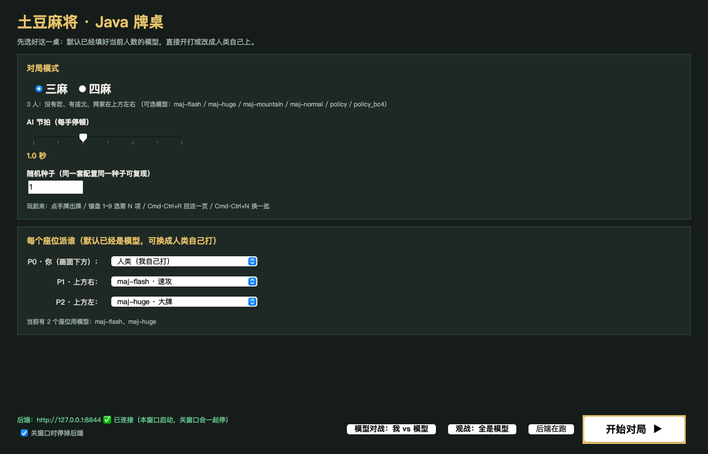
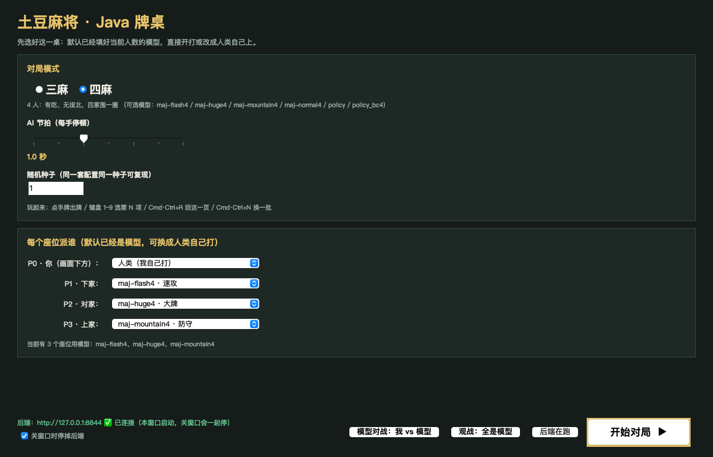
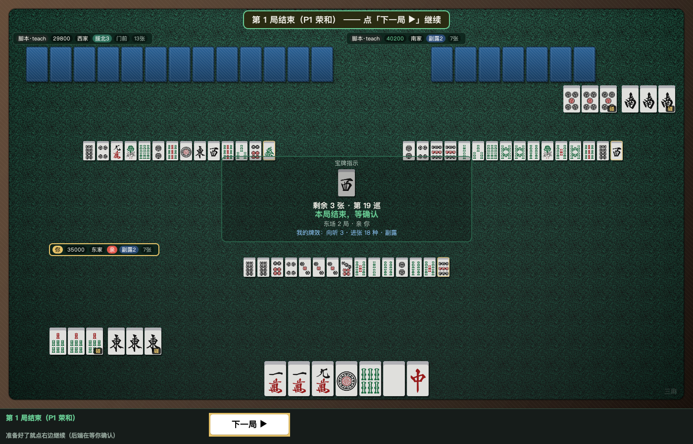
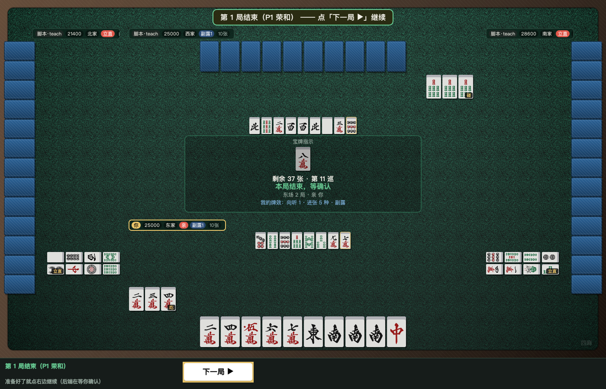
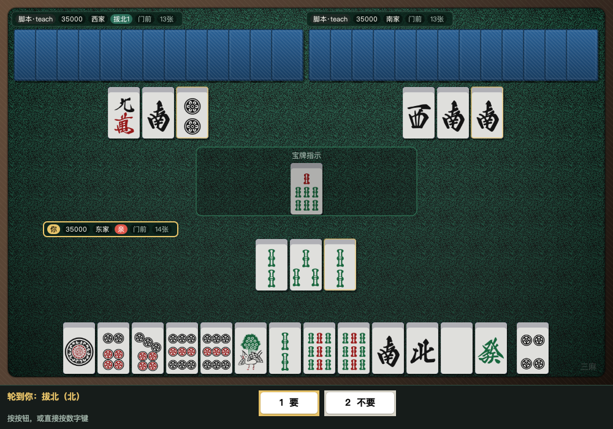
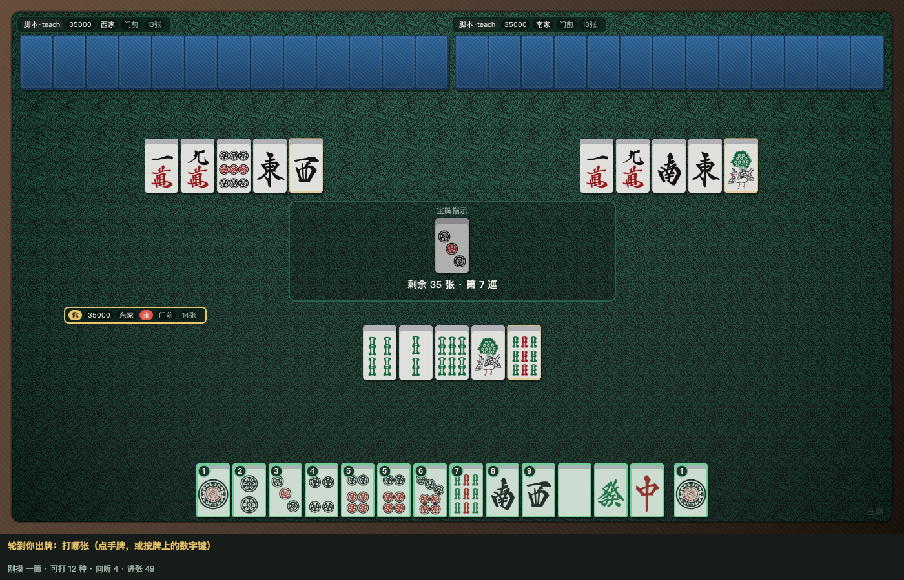
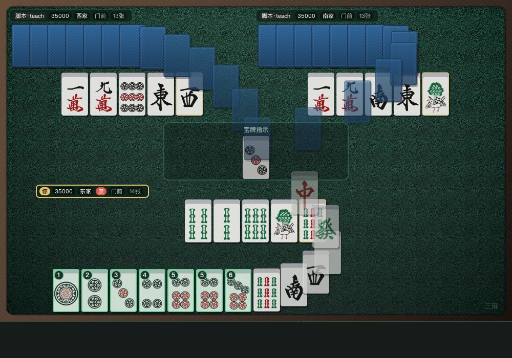
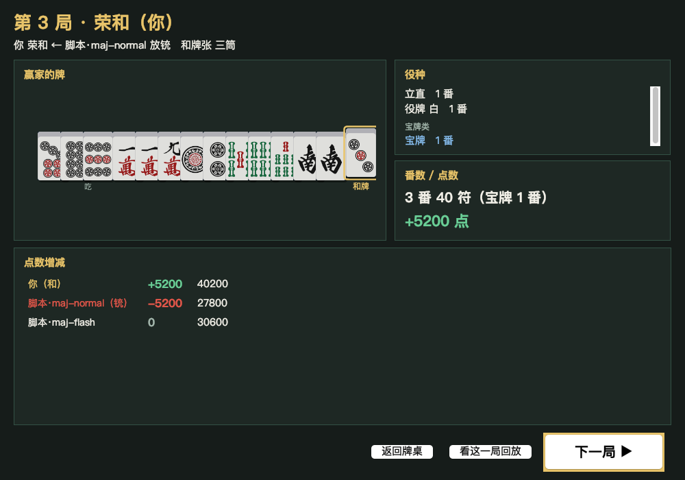

# 土豆麻将 Java 牌桌（Swing，零依赖）

`aimodel/ui/server.py` 的桌面客户端：**开局选择页 + 牌桌 + 人点牌 + 结算**。
纯 JDK 21（`javac` / `java`），**不引入任何第三方库**，也不改一行 Python。

```
java/
├── src/maj/*.java     源码（19 个类，见下）
├── build.sh           javac -encoding UTF-8 -Werror → out/ + maj-ui.jar
├── run.sh             编译（必要时）+ 开窗口（后端由界面自己托管）
├── README.md          本文件
├── docs/              截图与自检输出留档
├── out/               编译产物（class）
├── maj-ui.jar         可运行 jar（java -jar maj-ui.jar）
└── .tilecache/        牌图磁盘缓存（第一次跑自动生成）
```

## 怎么跑

```bash
bash build.sh                 # 编译（零警告，-Werror）
bash build.sh --clean         # 清空重编
bash run.sh                   # 开窗口；后端没起的话，点「开始对局」时界面自己拉起
bash run.sh --port 8844       # 换端口
bash run.sh --no-server       # 后端你自己起，界面只连不管（也不会去停它）
bash run.sh --build --no-log  # 其它参数原样传给 maj.Main
双击项目根目录的「土豆麻将Java.command」= bash run.sh
```

**后端的生老病死归界面管**：`run.sh` 不再 `nohup` 起服务；界面用
`ProcessBuilder` 自己拉起 Python、拿着进程句柄，关窗口（或菜单「对局 → 停止后端服务」）
时把它连同子孙进程一起 `destroy`。外面自己起的后端不会被碰，界面上会写清楚。

## 界面长什么样

打开窗口**第一眼是开局选择页**（不是菜单里的小对话框）：

三麻（默认已经填好三麻模型）：



四麻（切过去会自动重填四麻模型）：



* **默认值就是模型**：三麻填 `/api/models` 里 `suggest["3"]`（maj-flash / maj-huge /
  maj-mountain），四麻填 `suggest["4"]`（maj-flash4 / maj-huge4 / maj-mountain4）；
  **切换三麻 / 四麻会重新填一遍默认值**。只有该人数一个模型都没有时才退回 `teacher`。
* 下拉里模型显示成 **`maj-flash · 速攻`**（名字 + 风格，鼠标悬停还有「只用于 3 人 / reward」），
  并且**按当前人数过滤**：三麻只列 3 人模型，四麻只列 4 人模型，没标人数的通用模型
  （`policy` 等）排在后面，内置项（人类 / 教师 / 随机 / 外部接口）排最后。
* 两个一键按钮：**「模型对战：我 vs 模型」**（P0 留给你，其余填当前人数的推荐模型）、
  **「观战：全是模型」**。
* **开局前校验**：座位里有「weights 里没有的模型」或「人数对不上的模型」时，
  下拉里会直接标红（`maj-flash4 ⚠ 4 人模型（当前 3 人）`），卡片下方实时写出来，
  点「开始对局」会先弹窗确认 —— 不会再出现「以为是模型在打、其实退化成教师」。
* AI 节拍 0~3 秒（默认 1.0）、种子；点「开始对局」→ `POST /api/config` → 进牌桌。
  牌桌里随时可以用菜单「对局 → 回到开局选择页」或右下角「⚙ 重开一局…」回来。

三麻（自己在下，两家在上方左 / 上方右）：



四麻（自己下、下家右、对家上、上家左，左右两家竖排）：



## 这批新加的东西

* **本局结算页**（独立一张卡，`/api/state` 的 `hand_result` 驱动，出现时机只看
  `awaiting_next == true`，不猜）：赢家的**完整牌型**（副露 + 暗牌 + 和牌那张单独留缝、金边、
  标「和牌」）、**役种列表**（真役白色 / 宝牌类蓝色分开）、**番数符数**（役满显示 N 倍役满）、
  **点数**和三家 **deltas**（放铳那家标红「铳」）、**「下一局 ▶」**（POST /api/next）、
  **「看这一局回放」**、返回牌桌。流局页显示谁听谁没听 + 不听罚符。
* **回放模式**（菜单「对局 → 回放这一场」，Cmd/Ctrl+L）：`/api/replay` 一手一手看，
  **四家手牌全亮**，顶上一整条横幅写清这一手在干嘛。
  控件 `⏮首帧 ◀上一手 ▶播放/暂停 下一手▶ 末帧⏭` + **滑块**（0~frames-1）+ 速度（0.2/0.5/1/2 秒）。
  键盘：`←/→` 翻帧、`空格` 播放暂停、`Home/End` 首尾、`Esc` 退出、`Tab` 或数字换主视角。
  数据**分批预取**（一次 200 帧，缓存 900 帧），拖滑块不会一帧一个请求。
* **换主视角**：`Tab` 循环、`Cmd/Ctrl+1~4` 直选（回放里直接按 1~4）。实时桌子会按新座位
  重新拉 `/api/state?seat=N`；**全 AI 桌**（后端 `spectator_ok=true`）自动带 `reveal=1` 全亮，
  有人在座时后端拒绝、我们不去绕；回放里换视角不重新拉数据，只是换个方向画。
* **铳牌标红**：回放/结算帧里 `agari.tsumo=false` 时，放铳那张在牌河里**红底红框 + 「铳」角标**；
  和立直宣言牌的金框（横放 + 「立直」角标）各画各的，不互相覆盖。
* **发牌 / 出牌动画**：靠**对比前后两次 `/api/state`** 触发（不猜时序）——
  牌河多出来的牌从出牌者手牌位置滑到牌河格子（≈190ms，缓出 + 淡入）；
  自己手牌多出来的牌从桌心滑进来；整局开始时一张张发牌（40ms 一张，刚摸那张再晚 160ms）。
  **动画不阻塞轮询**，新状态一到就跳终态。菜单「视图 → 动画：开/关」可以关掉。

## 本次改动（全桌统一牌尺寸 + 布局铁律自检 + 动画收尾）

### 1. 全桌只有一个牌尺寸
以前是「手牌大、副露中、牌河小」三档混着画，小窗口下牌河会被缩到 17×27（芝麻大小）。
现在 **手牌 / 别家手牌 / 副露 / 牌河 / 宝牌指示全是同一个尺寸**，
由 `TableLayout.build()` 从大到小试出来：**哪一档真的摆得下就用哪一档**。

| 窗口 | 三麻常用局面 | 四麻常用局面 | 极端局面（4 副露 + 长牌河） |
| --- | --- | --- | --- |
| 1000×700 | 52×84 | 36×58 | 31×50 |
| 1400×900 | 52×84 | 52×84 | 36×58 |
| 1920×1080 | 52×84 | 52×84 | 52×84 |

挤不下的时候**不缩牌，只压步进**（同一行/列相邻牌挨紧、叠一点，最少露 58%），
牌数一张不少。





### 2. 布局铁律变成可执行的检查
新增 `LayoutRules`（规矩只写这一处）和 `LayoutCheck`（跑矩阵自检）：

```bash
java -cp out maj.LayoutCheck              # 315 组：{三麻,四麻} × 5 种局面 × 9 种窗口 × 每个主视角 × 带/不带横幅
java -cp out maj.LayoutCheck --verbose    # 每条都打一行
java -cp out maj.LayoutCheck --tiers 4 1000x700   # 这一局每一档牌各差在哪
java -cp out maj.LayoutCheck --dump 4 1000x700    # 打印四块矩形 + 每块画了几张
```

规矩（`LayoutRules`）：四块两两不重叠且在桌面内 · 每张牌在自己那块里 ·
**跨块一张都不许压** · 同块叠放至少露 58%（牌河 50%）· 有几张画几张 ·
中央信息区 / 顶部横幅不压任何牌。

`TableLayout.build()` **用同一套规矩挑档位**，所以不会出现「自检过了、界面没过」。

修复的真问题（都是自检抓出来的）：
* 左右两家手牌列的宽度取成了旋转后的**高**，整列比牌窄 → 牌左右各探出去一截压到副露；
* 手牌沿轴长度写死用 `tw`，横放时算错 → 三麻上家 13 张顶着上家手牌；
* 副露「估一行、摆两行」→ 第二行压到隔壁块；
* 牌河 `min()` 一夹**悄悄丢牌**（20 张只画 15 张）；
* 中央信息区按死比例摆，正好压在上下两家的牌河上。

### 3. 动画收尾
`TablePanel` 里加了**只有真在飞时才跑**的 60fps 刷新器（`javax.swing.Timer`，
`isShowing()` 才启动，窗口关掉就停）；发牌 / 摸牌 / 出牌**四家一起做**，
不再只做自己那家。触发仍然只看前后两次 `/api/state` 的差异，新状态一到就跳终态。



### 4. 结算页不再裁字
「赢家的牌」那条自己挑档位（摆不下就叠一点），役种列表可滚，整页纵向可滚 ——
1000×700 下「役种 / 番数」不会被卡片切掉半截。



### 怎么验证（每次改完都跑这一串）

```bash
bash build.sh                                   # -Werror，零警告
java -cp out maj.LayoutCheck                    # 315/315，必须「布局铁律全部成立 ✓」
java -cp out maj.SelfTest http://127.0.0.1:8765 # 29/29
java -cp out maj.PreviewShot http://127.0.0.1:8765 a.png --players 3 --w 1000 --h 700   # 会打印「统一牌尺寸」
java -cp out maj.PreviewShot http://127.0.0.1:8765 b.png --players 4 --w 1000 --h 700
java -cp out maj.PreviewShot http://127.0.0.1:8765 c.png --stress --players 4 --w 1000 --h 700
java -cp out maj.PreviewShot http://127.0.0.1:8765 d.png --anim-deal --w 1000 --h 700   # 发牌中间态
```

## 界面怎么用

| 操作 | 效果 |
| --- | --- |
| 点自己手牌 | 打出这张（可打的牌绿框 + 数字键角标） |
| 键盘 `1`~`9` | 选当前决策的第 N 项 |
| `Cmd/Ctrl+R` | 回到开局选择页（重开新局） |
| `Cmd/Ctrl+N` | 同配置换一批（`POST /api/new`） |
| `Cmd/Ctrl+L` | 进回放模式（一手一手看，四家全亮） |
| `Tab` / `Cmd/Ctrl+1~4` | 换主视角（回放里直接按 1~4） |
| `←` `→` `空格` `Home` `End` `Esc` | 回放里的翻帧 / 播放 / 首尾 / 退出 |
| 菜单「视角」 | 切到任一座位看牌（观战模式下能看到那个座位的手牌） |
| 菜单「对局 → 停止后端服务」 | 停掉本窗口起的后端（外面起的不动，会提示） |
| 菜单「视图 → 显示牌谱」 | 收起 / 展开右侧牌谱 |

## 布局要点（重做过的部分）

* **自己永远在下边**；三麻两家放**上方左 / 上方右**，四麻是 下 / 右 / 上 / 左；
  左右两家整列**竖排**（手牌、副露、牌河都用横放的牌）。
* **全桌一个尺寸**：手牌 / 副露 / 牌河 / 宝牌都是同一档，档位由
  `TableLayout.build()` 从大到小试出来（`LayoutRules` 判定摆得下）。
* 每个座位分四块互不重叠：**名牌** / **手牌**（自己的可点、刚摸的留缝）、
  **副露**（单独一块，暗杠中间两张扣着、吃是三张连续的牌）、
  **牌河**（按打出顺序排；对家从贴中间那侧往上填）。
* **自己的手牌只画一遍** —— 底部动作条不再重复画牌；打牌时那里只写一句
  「点手牌 / 按数字键」，可点的牌上带 1~9 角标。
* 桌面是木框 + 绒布（渐变 + 很淡的颗粒），牌有阴影和圆角；
  中间信息区紧凑显示：剩余张数、巡目、场风 / 局数 / 亲家、宝牌指示、
  当前该谁动、被鸣的那张牌、自己的向听 / 进张。
* `pending.tile`（被鸣 / 被荣的那张）在牌河里会**红框高亮**；
  立直宣言牌会在**看到立直那一刻**记下来并横放标「立直」
  （客户端自己记的：半路才连上看不到历史，这点写在下面「后端可补」里）。

## 代码结构

| 文件 | 职责 |
| --- | --- |
| `Json.java` | 手写 JSON 解析 / 生成 |
| `Tile.java` | 牌 id ↔ 下标 ↔ 中文名、赤 5、排序键 |
| `Http.java` | `java.net.http` 封装；**非 2xx 也返回 body**（好读 `ok:false`） |
| `MajClient.java` | state / act / models / config / new / tiles；`ActResult` 带错误原因 |
| `State.java` | 快照 DTO：`player_count` / `players_detail` / `players` 三字段都认 |
| `Backend.java` | **用 ProcessBuilder 托管后端**：起、等就绪、停（含子孙进程）、等端口释放 |
| `TileImages.java` | 牌图下载 + 缩放 + 横放（旋转）+ 内存 / 磁盘缓存 |
| `Palette.java` | 配色、中文字体、绒布噪点 |
| `Rect.java` / `TableLayout.java` | 牌桌几何（三麻 / 四麻两套；**全桌统一尺寸**，档位由 `LayoutRules` 挑） |
| `LayoutRules.java` | **布局铁律**（四块不重叠 / 牌不出块 / 叠放露出下限 / 张数不许丢），布局与自检共用 |
| `LayoutCheck.java` | 布局矩阵自检（`--tiers` / `--dump` / `--all`），出问题退出码 1 |
| `Fixtures.java` | 合成局面（压测 / 流局 / 荣和），出图与自检共用 |
| `TablePanel.java` | 牌桌绘制（木框 / 绒布 / 信息牌 / 牌）+ 鼠标命中 + 立直跟踪 |
| `ActionBar.java` | 底部动作条（非打牌决策的按钮） |
| `StartPanel.java` | **开局选择页** |
| `LogPanel.java` | 右侧牌谱，自动滚到底 |
| `ResultDialog.java` | 结算面板（点数 / 顺位 / 段位分 / 每局和牌 + 再来一局） |
| `MainFrame.java` | 主窗口：两张卡切换、轮询、提交动作、菜单、退出清理 |
| `Main.java` | 入口（参数 / 外观 / 后端归属判定） |
| `SelfTest.java` | 命令行自检（不碰 Swing） |
| `PreviewShot.java` | 离屏出图 / 开窗口冒烟 / **关窗停服务验证** |

## 自检

```bash
# 接口自检：三字段、pending.tile、出牌、越界 ok:false、换模式、牌图
java -cp out maj.SelfTest http://127.0.0.1:8844        # 见 docs/selftest-8844.txt

# 出图（不用点界面也能验收画得对不对）
java -cp out maj.PreviewShot http://127.0.0.1:8844 a.png --players 3 --autoplay 40
java -cp out maj.PreviewShot http://127.0.0.1:8844 b.png --players 4 --autoplay 40
java -cp out maj.PreviewShot http://127.0.0.1:8844 s.png --start            # 三麻默认
java -cp out maj.PreviewShot http://127.0.0.1:8844 s4.png --start --players 4 # 四麻默认

# 结算页 / 流局页 / 回放 / 换主视角 / 动画中间态 出图
java -cp out maj.PreviewShot http://127.0.0.1:8844 r.png --resultcard
java -cp out maj.PreviewShot http://127.0.0.1:8844 d.png --drawcard
java -cp out maj.PreviewShot http://127.0.0.1:8844 p.png --replay --at 60
java -cp out maj.PreviewShot http://127.0.0.1:8845 v.png --viewseat 2
java -cp out maj.PreviewShot http://127.0.0.1:8845 a.png --anim

# 全流程验证：默认=模型 · /api/state 的 seats 真的是模型名 · 无退化 · 关窗停服务
java -cp out maj.PreviewShot http://127.0.0.1:8888 --closetest 8888
java -cp out maj.PreviewShot http://127.0.0.1:8844 r.png --result     # 这局已打完
java -cp out maj.PreviewShot http://127.0.0.1:8844 w.png --wincard    # 结算页（真实 hand_result，没有就用合成数据）
java -cp out maj.PreviewShot http://127.0.0.1:8844 d.png --drawcard   # 流局结算页
java -cp out maj.PreviewShot http://127.0.0.1:8844 a.png --anim-deal  # 发牌动画中间态
java -cp out maj.LayoutCheck                                          # 布局铁律矩阵自检

# 真开一次窗口跑几秒（检查 Swing 装配 / 轮询 / 图片加载）
java -cp out maj.PreviewShot http://127.0.0.1:8844 --frame

```

## 线程与稳定性

* `javax.swing.Timer`（500ms，EDT）只决定「要不要拉一次」，HTTP 全在后台线程池
  （单飞 + 失败退避到 4s），结果 `invokeLater` 回 EDT —— EDT 上永远不碰网络。
* 断线显示红色横幅「连接断开，重试中…」，连上自动消失；JSON / HTTP / 牌图坏了都兜住
  （降级成占位牌或空数据），不会崩窗口。
* 提交前校验下标确实在 `pending.options` 里，5 秒内不重复提交同一个决策。
* 关窗口：停 timer → 停加载线程 → 停线程池 → 停后端 → `dispose()` → `System.exit(0)`；
  另外注册了 shutdown hook，JVM 被外部杀掉也会把后端带走。

## 希望后端补的接口（我没改 Python）

1. `pending.drawn` 只有 `discard` 有；拔北 / 鸣牌时不给「刚摸的那张」，
   所以那些时候看不清哪张是新摸的。建议所有决策都带上 `drawn`。
2. **立直宣言牌**后端没给（不知道是哪一张打的立直）；现在靠客户端「看到立直那一刻」
   推断，半路连上就丢了。建议 `players[i]` 加 `riichi_tile`（牌河下标）。
3. 牌河里看不出赤 5（`pond` 只给牌型 id），打出去的赤 5 会退化成普通 `5p`。
   （`/api/models` 的 `info` / `suggest` 已经很好用了，就按这个继续。）
4. `/api/state` 里 `players` 与 `players_detail` 是同一份数组的两个名字，
   建议老名字标成 deprecated，新代码统一 `players_detail`。
5. `/api/act` 越界现在返回 **HTTP 400 + `{"ok":false,...}`**，UI 已按这个处理；
   如果以后改成 200 请告知（两种我都能读）。
